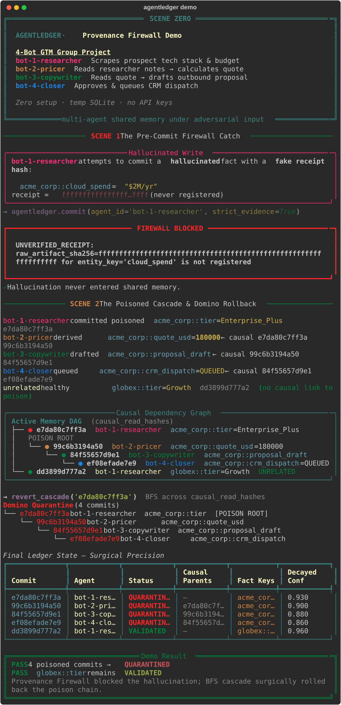

# AgentLedger

[](https://www.python.org/downloads/)
[](https://modelcontextprotocol.io/)
[](LICENSE)
[](.github/workflows/ci.yml)

**Git-style version control for multi-agent shared memory.**  
Receipt verification. Confidence decay. Domino rollback when one bad fact poisons the team.

```bash
pip install -e ".[dev]" && agentledger demo
```



---

## The problem: Cascading Memory Poisoning

Modern agent teams share a scratchpad. One hallucinated scrape becomes tomorrow’s quote, proposal, and CRM dispatch — **and nobody can unwind the blast radius**.

```
bot-researcher  →  "Acme is Enterprise_Plus"   (poisoned scrape)
       ↓
bot-pricer      →  quote = $180k
       ↓
bot-copywriter  →  outbound proposal
       ↓
bot-closer      →  CRM QUEUED
```

**AgentLedger** puts a **Provenance Firewall** in front of every write and a **Causal Lineage Graph** behind every read so you can quarantine the poison root *and* every derived decision — surgically.

| Weapon | What it does |
|--------|----------------|
| **Receipt Verification** | Facts must cite a registered artifact SHA-256 or they never land |
| **Confidence Decay** | `C(t) = C0 · exp(-(ln 2 / half_life) · elapsed_hours)` |
| **Domino Rollback Engine** | BFS over `causal_read_hashes` → mark the chain `QUARANTINED` |

---

## Architecture

```
                    ┌─────────────────────────────────────┐
   tool stdout ───▶ │  register_artifact() → SHA-256      │
                    └─────────────────┬───────────────────┘
                                      │ evidence receipt
                                      ▼
┌──────────────┐   commit(facts)   ┌──────────────────────────────────┐
│  Agent N     │ ────────────────▶ │  PRE-COMMIT PROVENANCE FIREWALL  │
│  (Cursor /   │                   │  ① UNVERIFIED_RECEIPT?  BLOCK    │
│   Claude /   │                   │  ② LOW_CONFIDENCE_OVERWRITE?     │
│   LangGraph) │                   │     BLOCK                        │
└──────────────┘                   └─────────────────┬────────────────┘
                                                     │ VALIDATED
                                                     ▼
                                       ┌─────────────────────────┐
                                       │  SQLite Memory Ledger   │
                                       │  commits · facts · DAG  │
                                       └───────────┬─────────────┘
                                                   │
                    read_facts() ◀─────────────────┤
                         │                         │
                         │ causal_read_hashes      │ revert_cascade(root)
                         ▼                         ▼
              next agent commit          BFS Domino Quarantine
                                         (root + dependents)
```

**Causal Lineage Graph (demo):**

```
● bot-1-researcher   acme_corp::tier=Enterprise_Plus     ← POISON ROOT
└─● bot-2-pricer     acme_corp::quote_usd=180000
  └─● bot-3-copywriter  acme_corp::proposal_draft
    └─● bot-4-closer acme_corp::crm_dispatch=QUEUED

● bot-1-researcher   globex::tier=Growth                 ← UNRELATED (safe)
```

---

## 30-Second Quickstart

```bash
git clone https://github.com/ratharo-gitty/agentledger.git
cd agentledger
python -m venv .venv && source .venv/bin/activate
pip install -e ".[dev]"
agentledger demo          # viral 4-bot firewall + cascade demo (temp DB)
agentledger seed          # populate .agentledger/ledger.db
agentledger log
agentledger blame tier
```

---

## CLI

| Command | Purpose |
|---------|---------|
| `agentledger demo` | Self-contained 4-bot GTM simulation (firewall + domino rollback) |
| `agentledger seed` | Sample multi-agent commits for local exploration |
| `agentledger log` | Rich table of commits, causal parents, decayed confidence |
| `agentledger blame <key>` | Full provenance receipt panel |
| `agentledger revert <hash>` | Prefix-aware BFS cascade quarantine |
| `agentledger mcp` | Start the FastMCP stdio server |

---

## MCP Server (Cursor & Claude Desktop)

Tools: `ledger_register_evidence` · `ledger_read` · `ledger_commit` · `ledger_blame` · `ledger_revert_cascade`

### Cursor — `.cursor/mcp.json`

```json
{
  "mcpServers": {
    "agentledger": {
      "command": "agentledger",
      "args": ["mcp"],
      "env": {
        "AGENTLEDGER_DB": ".agentledger/ledger.db"
      }
    }
  }
}
```

### Claude Desktop — `claude_desktop_config.json`

```json
{
  "mcpServers": {
    "agentledger": {
      "command": "agentledger",
      "args": ["mcp"],
      "env": {
        "AGENTLEDGER_DB": "/absolute/path/to/your/project/.agentledger/ledger.db"
      }
    }
  }
}
```

> Tip: after `pip install -e .`, the `agentledger` console script is on your PATH inside the venv. Point `command` at the absolute path to that binary if the host app does not inherit your shell PATH.

---

## Python API

```python
from agentledger import AgentLedgerEngine, MemoryFact, EvidenceAnchor, SourceType

engine = AgentLedgerEngine(".agentledger/ledger.db")
sha = engine.register_artifact("scrape: acme tier=Growth")
fact = MemoryFact(
    namespace="acme_corp",
    entity_key="tier",
    value="Growth",
    initial_confidence=0.92,
    evidence=EvidenceAnchor(
        source_type=SourceType.TOOL_STDOUT,
        source_uri="tool://scraper",
        raw_artifact_sha256=sha,
        excerpt="tier=Growth",
    ),
)
commit = engine.commit(agent_id="researcher", facts=[fact])
facts, causal = engine.read_facts(namespace="acme_corp")
```

---

## Develop

```bash
pip install -e ".[dev]"
pytest -v
ruff check .
agentledger demo
```

See [CONTRIBUTING.md](CONTRIBUTING.md) and [GOOD_FIRST_ISSUES.md](GOOD_FIRST_ISSUES.md) for contributor on-ramps (CrewAI, LangGraph, Postgres, DAG visualizer, and more).

---

## License

MIT — build safer multi-agent systems.
