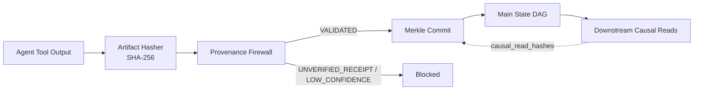

<div align="center">

# AgentLedger

**Git-style version control, cryptographic receipts, and cascading rollbacks for multi-agent shared memory.**

[](https://github.com/ratharo-gitty/agentledger/actions/workflows/ci.yml)
[](https://www.python.org/downloads/)
[](https://modelcontextprotocol.io/)
[](LICENSE)
[](https://github.com/ratharo-gitty/agentledger/issues?q=is%3Aissue+is%3Aopen+label%3A%22good+first+issue%22)

<br/>


<sub>Terminal demo — Provenance Firewall catch + BFS domino quarantine (zero API keys)</sub>

<br/>

```bash
pip install -e ".[dev]" && agentledger demo
```

</div>

---

## Why AgentLedger?

Multi-agent teams share memory. One hallucinated scrape becomes a quote, a proposal, and a CRM dispatch — **cascading memory poisoning** with no unwind button.

AgentLedger puts a **Provenance Firewall** in front of every write and a **Causal Lineage Graph** behind every read so you can quarantine the poison root *and* every derived decision.

| Weapon | What it does |
|--------|----------------|
| **Cryptographic Receipts** | Facts must cite a registered artifact SHA-256 or they never land |
| **Confidence Half-Life Decay** | `C(t) = C0 · exp(-(ln 2 / half_life) · elapsed_hours)` |
| **Cascading Rollback (BFS)** | Walk `causal_read_hashes` → mark the chain `QUARANTINED` |

---

## Lifecycle



---

## Comparison

| Feature | AgentLedger | Mem0 / Zep | Raw Redis / JSON |
|---------|:-----------:|:----------:|:----------------:|
| Cryptographic Receipts | ✅ | ❌ | ❌ |
| Confidence Half-Life Decay | ✅ | ⚠️ partial | ❌ |
| Cascading Rollback (BFS) | ✅ | ❌ | ❌ |
| Model Context Protocol (MCP) | ✅ | ❌ | ❌ |
| Embedded Zero-Cloud (SQLite) | ✅ | ❌ | ⚠️ DIY |

---

## Quickstart

```bash
git clone https://github.com/ratharo-gitty/agentledger.git
cd agentledger
python -m venv .venv && source .venv/bin/activate
pip install -e ".[dev]"
agentledger demo
agentledger seed
agentledger log
```

<details>
<summary><strong>Cursor</strong> — <code>.cursor/mcp.json</code></summary>

```json
{
  "mcpServers": {
    "agentledger": {
      "command": "agentledger",
      "args": ["mcp"],
      "env": {
        "AGENTLEDGER_DB": ".agentledger/ledger.db"
      }
    }
  }
}
```

> After `pip install -e .`, point `command` at the absolute path to the `agentledger` binary if Cursor does not inherit your venv PATH.

</details>

<details>
<summary><strong>Claude Desktop</strong> — <code>claude_desktop_config.json</code></summary>

```json
{
  "mcpServers": {
    "agentledger": {
      "command": "agentledger",
      "args": ["mcp"],
      "env": {
        "AGENTLEDGER_DB": "/absolute/path/to/your/project/.agentledger/ledger.db"
      }
    }
  }
}
```

</details>

<details>
<summary><strong>Python SDK</strong></summary>

```python
from agentledger import AgentLedgerEngine, MemoryFact, EvidenceAnchor, SourceType

engine = AgentLedgerEngine(".agentledger/ledger.db")
sha = engine.register_artifact("scrape: acme tier=Growth")
fact = MemoryFact(
    namespace="acme_corp",
    entity_key="tier",
    value="Growth",
    initial_confidence=0.92,
    evidence=EvidenceAnchor(
        source_type=SourceType.TOOL_STDOUT,
        source_uri="tool://scraper",
        raw_artifact_sha256=sha,
        excerpt="tier=Growth",
    ),
)
commit = engine.commit(agent_id="researcher", facts=[fact])
facts, causal = engine.read_facts(namespace="acme_corp")
```

MCP tools: `ledger_register_evidence` · `ledger_read` · `ledger_commit` · `ledger_blame` · `ledger_revert_cascade`

</details>

---

## CLI

| Command | Purpose |
|---------|---------|
| `agentledger demo` | Self-contained 4-bot GTM simulation (firewall + domino rollback) |
| `agentledger seed` | Sample multi-agent commits for local exploration |
| `agentledger log` | Rich table of commits, causal parents, decayed confidence |
| `agentledger blame <key>` | Full provenance receipt panel |
| `agentledger revert <hash>` | Prefix-aware BFS cascade quarantine |
| `agentledger mcp` | Start the FastMCP stdio server |

---

## Develop

```bash
pip install -e ".[dev]"
pytest -v
ruff check .
agentledger demo
```

See [CONTRIBUTING.md](CONTRIBUTING.md) and [GOOD_FIRST_ISSUES.md](GOOD_FIRST_ISSUES.md) for contributor on-ramps (CrewAI, LangGraph, Postgres, DAG visualizer, and more).

---

## License

[MIT](LICENSE) — build safer multi-agent systems.
